# 智能车设计与制作日志

> 队伍：致远战队（实训战队：千里战队）｜队长：傅国钊｜记录周期：2026.9.18 – 2026.10.19，本项目为 1 辆参赛车。文档按机器人功能划分板块，每个板块先写功能描述，再按开发时间从早到晚记录开发历程。10.17–10.18 的整车调试问题按所属功能拆入对应板块，问题编号沿用原始调试日志（因此同一编号可能出现在不同板块）。

**已实现功能一览**

| 功能 | 实现方式 | 状态 |
| --- | --- | --- |
| 电源系统 | 2×18650 串联（7–8.4V）→ 遥控继电器 → XH2.54-2p → DC-DC 降压 5V，供主控、电机驱动、舵机 | 已完成并装机；首板降压板输出接反已飞线修复，改版需加防反接与总开关 |
| 主控系统 | STM32F103C8T6 核心板，两排 1×20p 排母直插底板，ST-Link 调试 | 已实现；10.18 发现一块核心板 3.3V LDO 损坏，已更换新板 |
| 全向移动底盘 | 4×TT 减速电机 + 麦轮，2×DRV8833 驱动，软件 PWM 调速，支持前进/后退/左右平移/原地旋转 | 已实现并完成遥控联调；自转、前进后退正常，平移受四轮个体差异影响（左后轮摩擦大、左前轮起步电压高、同压转速不一致），需换轮/换电机或加陀螺仪动态调整 |
| 方块夹取机构 | 995 舵机×3 + SG90×1，4 路硬件 PWM，底板上 4 个直插接口 | 4 路舵机控制已实现；10.17 测试无反应定位为 PCB 引脚注释错位 |
| PS2 遥控 | PS2 无线手柄 + 直插转接板，SPI1 读取 | 已实现，可遥控整车平动、平移、旋转 |
| PCB 集成底板 | 自绘底板集成电源、主控、电机驱动、舵机、PS2 接口 | 已完成两轮打板与焊接，10.17 完成整机组装 |
| 整车结构与重量 | 亚克力底盘承载各模块，按 3.3.3 结构规范选材布线，整车 964g | 已完成第一次组装 |

## 一、电源系统

**功能描述**：两节 3.7V 18650 电池串联供电（7–8.4V），经遥控继电器、XH2.54-2p 接入底板，再由 DC-DC 模块降压到 5V，供主控板、电机驱动和舵机使用。按单个电机空载/堵转电流与 3–4 个舵机估算，总电流约 4A，选用 3A 稳压模块。供电要求：可断电（加开关）、避免反接、舵机与主控分开供电以减少干扰。

### 9.18 方案与器件选型

- 电源：
  - 两节3.7V 18650电池串联-电池盒 供电7-8.4V ->[遥控继电器]->XH2.54-2p ->底板->dc-dc模块降压至5V->主控板、电机驱动、舵机
  - DC-DC模块：
    - 一个电机空载电流<200mA，堵转<0.6A?，加上3-4个舵机的电流<2A
    - 总共最大电流约4A，购买Mini DC-DC降压电源模块 3A稳压模块即可
    - 模块有邮票孔，可以直接焊到底板上
    - 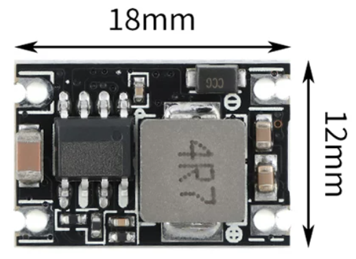
    - 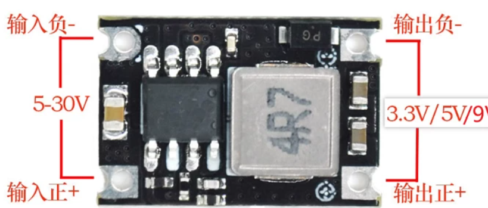

### 10.10焊接测试：电源问题

- 降压板输出口正负接反，暂时飞线解决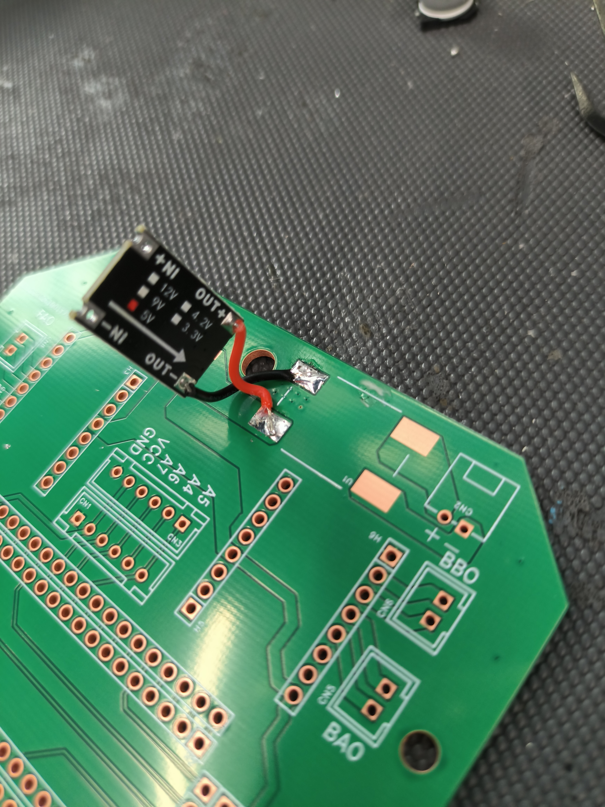
- 电池没有防反接，不管了，xh2.54应该不会反插吧
- 断电要拆电池（加开关）
- 核心板和舵机共用电源+5V，可能会有干扰，舵机和核心板电源分开走，加开关

### 10.17 问题一：xh2.54接线端子接上之后芯片灯不亮。

- 猜想一：电池电量不足？
- 排查：万用表测电池盒两侧电压，均为预期的8V。
- 猜想二：线接触不良？
- 排查：多次使用万用表测量接线端子时出现有时有电压，有时无电压的情况。
- 解决：经硬件组同学排查，发现电控万用表测量位置有误

## 二、主控系统与调试接口

**功能描述**：以 STM32F103C8T6 核心板作为整车主控，通过两排 1×20p 排母直插底板，负责电机 PWM、舵机 PWM、PS2 手柄读取与上电自检；调试使用 ST-Link。

### 9.18 核心板选型与接口设计

- 主控：stm32f103c8t6核心板 购买micro焊接版
  - 与底板连接方式：排母直插（两排1x20p）/排针直接焊接 两排针间距15.24mm
  - 调试：使用stlink [10.10焊接后发现调试排针挡住舵机接口了！核心板上调试接口DIO、DCLK接口在侧边由排针引出，设计时留出杜邦线空间]
  - 核心板引脚定义：
    - 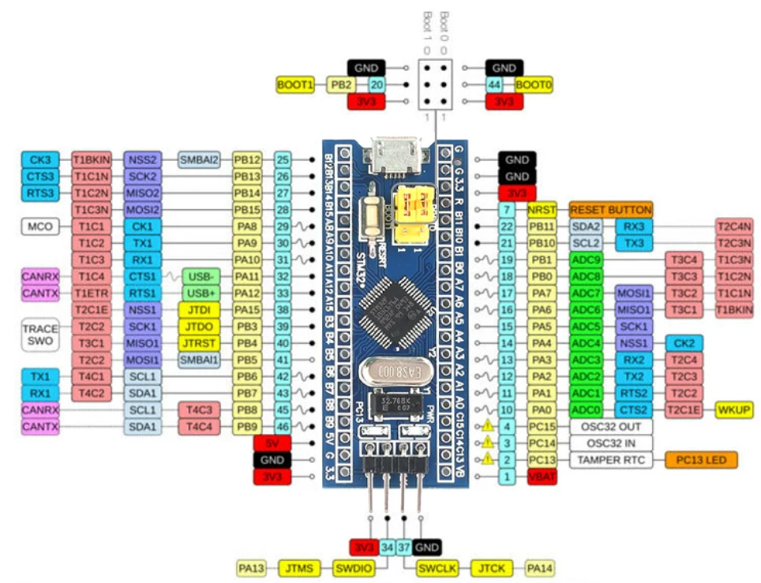

### 10.10焊接测试：主控接口问题

- 调试接口与1舵机接口冲突
  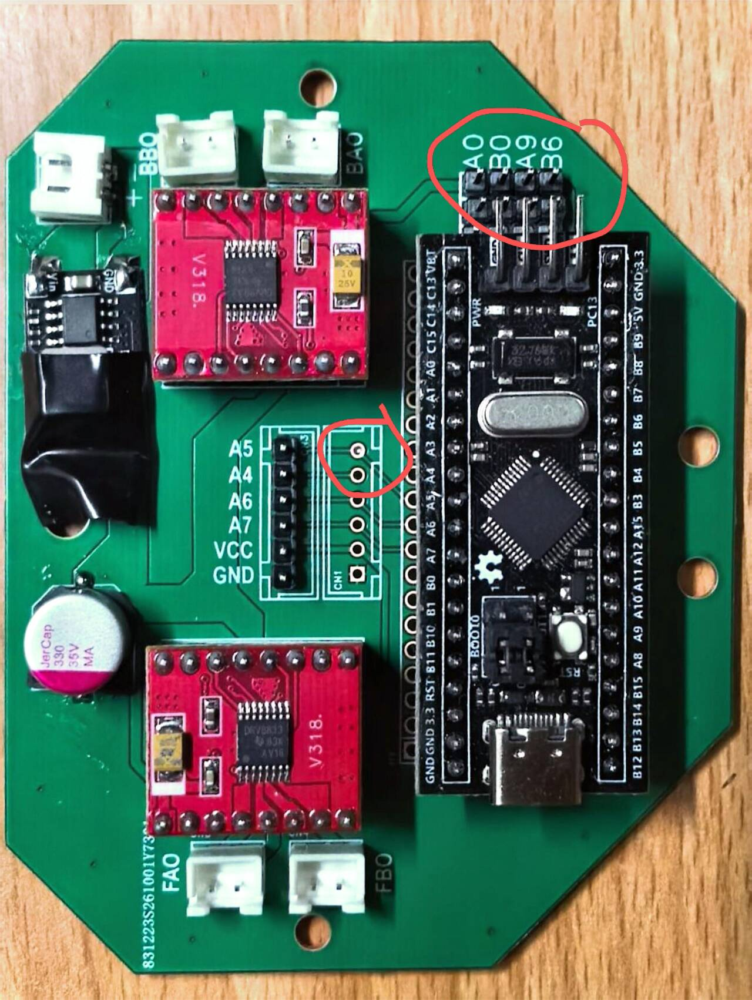
- 软件要重新分配引脚，等待引脚分配结果

### 10月18日 问题一：主控板和接收器灯亮度低，原来3.3V的电压测试到2点几V

- 解决：更换新主控板，但是接stlink时原主板仍然可用
- 结论：主控板上3.3V的ldo坏了

## 三、全向移动底盘（四轮麦轮）

**功能描述**：4 个 TT 减速电机（3–6V，1:48）配麦轮实现全向移动，2 片 DRV8833 一前一后各驱动两个电机，采用软件 PWM 调速，目标是前进、后退、左右平移、原地旋转四种动作；运动分快速、慢速两档，可用手柄按键切换。

### 速度模式：快速 / 慢速

底盘运动提供快速、慢速两档速度，通过手柄按键切换：

- **快速模式**：摇杆推满时按设定的速度上限输出，用于场地间转场、快速接近目标；
- **慢速模式**：速度上限降低，摇杆小行程时也能稳定低速移动，用于对准方块、精细平移和夹取前的姿态调整。

两档只改变速度上限，麦轮解算、方向判断与转向逻辑不变，所以切换档位不会改变运动方向，也不会出现切换瞬间的顿挫。

### 9.18 电机与驱动选型

- 四轮：
  - 电机：
    - 四个tt减速电机3V-6V 1:48
    - 暂定5V供电
    - *可直接从DC-DC模块取电，并且驱动电压不会随电池电压改变而受影响，保证转速基本稳定*
    - 接口：底板->XH2.54-2p->电机
  - 驱动：
    - 2xDRV8833模块 一前一后各控制两个电机
    - 引脚图（！背面）
    - 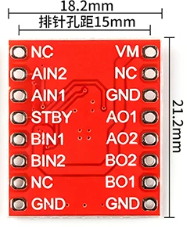
    - A/B IN 1/2接stm32 软件pwm[stm32驱动引脚就近，用软件pwm]
    - A/B O 1/2接电机
    - STDBY接5V
    - VM接5V

### 10.11 电机启动与供电调整

- 测试pwm不行，可能电机启动电流过大，一开始用pwm无法让电机起转，将电机供电改为电池直接供电
- 等待测试舵机正常后重新打板

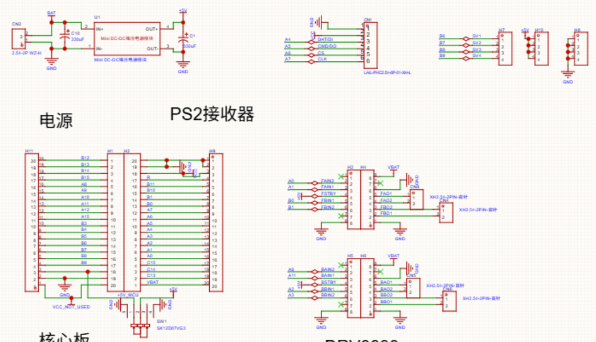
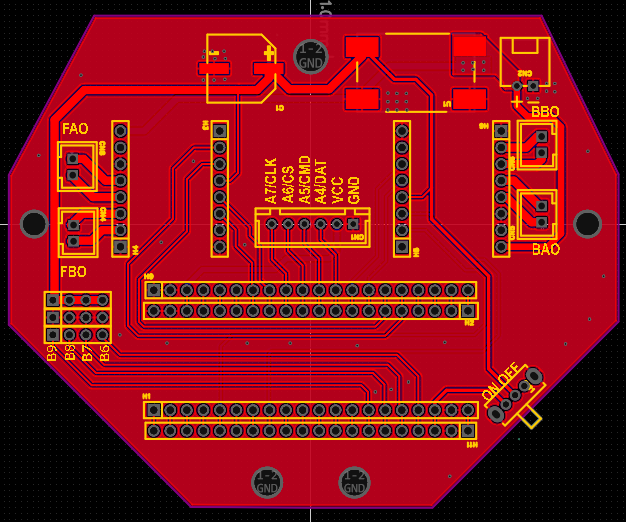

### 10月17日 上电自检

- 注释：自检：四个轮子先各自前后转，然后再整体向前向后，测试整车的前进与后退，最后测试整车左右平移。

### 10月17日 问题二：自检时最后一步时只有两个轮子在转且整车未成功平移，且使用PS2遥控时，整车旋转时两个轮子卡住不动和左右平移出现问题。

- 猜想一：功率不足，转速过大导致电流过大，使得电压过小。
- 排查：降低转速，从而保证功率足够
- 结果：与最初时无明显差异，同时在旋转时有两个轮子不动，并且发出嗡嗡声。
- 继续排查：让轮子悬空转，发现四个轮子都可以正常运动。

**重大发现！！！**

- 代码上自检轮子的顺序是FL,FR,RR,RL而实际上自检顺序是FL,RR,FR,RL。FR和RR电机的线接反了。

### 10月17日 新问题三：更换接线之后自检时左右平移没有走直线，而是整车做顺时针的旋转

- 猜想：实验室地板过滑
- 排查：在室外的地板实验，测试稍微好转，但是问题仍然存在
- 调试：不断地修改转速
- 结果：前后运动和向右平移较稳定，但是向左平移仍然偶发性地旋转
- 新发现：左前轮上的一个辊子卡死
- 排查：更换新轮子，但是问题仍然存在

**重大发现！！！**

- 左前轮一直悬空。
- 解决：加重物（暂时搁置）（晚上已完成）但是仍然不能完成正常的检录操作

### 10.18 轮子个体差异排查

- 左后轮有明显的凝滞感，判断是电机本身的问题——内部摩擦力偏高。这也能解释之前不断调整转速时的现象：前面一个轮子刚调好、左移没问题，稍微加速就又出问题（这是物理层面的差异，不是参数没调对）。
- 左前轮所需的起步电压比其他三个轮子高，起步更晚，所以左移一开始就会少力。
- 除上述问题外，4 个轮子在同一电压输入下转速不一致。这也解释了之前右移比较平稳——右移主要使用右侧两个轮子，相对稳定。

**判断**：目前整车在自转、前进后退上没有问题；但平移精度受四轮个体差异限制。更直白地说：要么换轮子/换电机，要么加陀螺仪模块做动态调整，否则麦轮没有想象中那么好用。

- 排查过程中对接线做了焊接返工（热缩管绝缘）：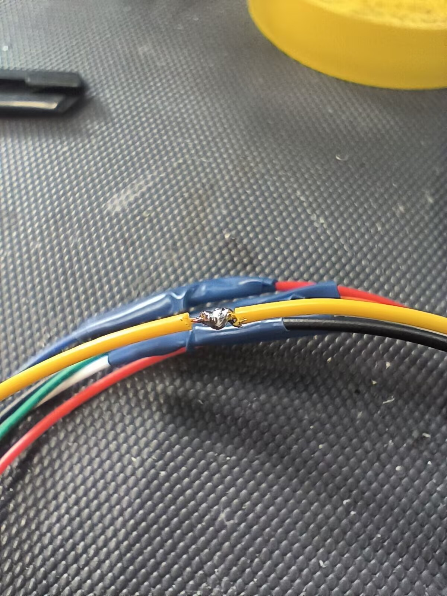

### 10.19 PWM 频率与占空比测试

现象：10.11 把电机改为电池直接供电后，台架硬件测试时电机能转，但接入整车固件（嵌入式程序）后麦轮反而转不起来，于是专项排查 PWM 参数。

- 20 kHz、占空比 40%：不转。怀疑是电压不够，或者频率太高、驱动板跟不上；
- 占空比 100%：可以转；
- 频率降到 100 Hz：也可以转。

进一步用控制变量法对比同一供电下的转速：

> 20 kHz / 80% 的速度 ＜ 100 Hz / 40% 的速度 ＜ 1 kHz / 80% 的速度

结论：

1. 所用 TT 减速电机的**启动电压要求较高**，占空比较低时有效电压不足以让电机起转；
2. 可能是**驱动板的问题**：频率越高，有效占空比越小、输出平均电压越低，所以 20 kHz 下即使 80% 占空比，转速仍低于 100 Hz / 40% 和 1 kHz / 80%。

阶段结论：电机 PWM 需要降低频率（并保证启动占空比足够），才能兼顾起转与低速性能。

## 四、方块夹取机构（舵机）

**功能描述**：995 舵机×3 + SG90×1 共 4 路舵机组成夹取/升降机构。STM32F103C8T6 只有 4 个硬件定时器，为保证稳定全部使用硬件 PWM，因此舵机数量限定为 4 个；底板上设计 4 个舵机排针接口，舵机可直插，无需改线。

### 9.18 舵机选型与接口设计

- 方块夹取机构:
  - 舵机：[数量:stm32f103c8t6只有4个硬件tim，为稳妥舵机都使用硬件pwm，因此限定了舵机最多4个]995舵机×3 SG90×1
  - 接口：排针（舵机可直插，无需改线），用胶水固定，设计4个舵机接口
  - 线序：GND-5V-S 4-5个pwm[stm32驱动引脚:TIM4 PB6/7/8/9 TIM3 PB0/1 TIM2 PA0/1/2/3 TIM1 PA8/9/10/11]

### 10.15 舵机供电画反与补救

- 发现舵机5V和GND画反了，但是我已经打板了
- 目前补救方案：
  1. 重新打板，时间来不及，赶不上中期测评
  2. 舵机改线、
  3. 杜邦线转接
- 先3.测试功能和过中期测评，后面再重新打板

### 10月17日 问题四：舵机测试时无反应

- 排查：万用表测试发现不是线的问题
- 解决：最后发现时PCB板上的引脚注释错位。

### 10.18 机械臂限位

- 机械臂需要限位，防止舵机超出行程。

## 五、PS2 遥控

**功能描述**：官方推荐的 PS2 无线手柄（锁定款）+ 直插转接板，经 SPI1 与主控通信，用于遥控整车的平动、平移与旋转。

### 9.18 选型与接线方案

- PS2遥控：
  - 手册推荐 PS2 无线手柄锁定款 + 直插 转接板（排针）
  - 感觉用XH2.54两端连接更可靠
  - [暂定]转接板（XH2.54）两端XH2.54-6p公头线连接
  - 线序：使用XH2.54需注意线序，设计PCB时预留两个方向，根据情况选用
    - GND-VCC-DAT-CMD-CS-CLK[stm32驱动引脚SPI1]
    - 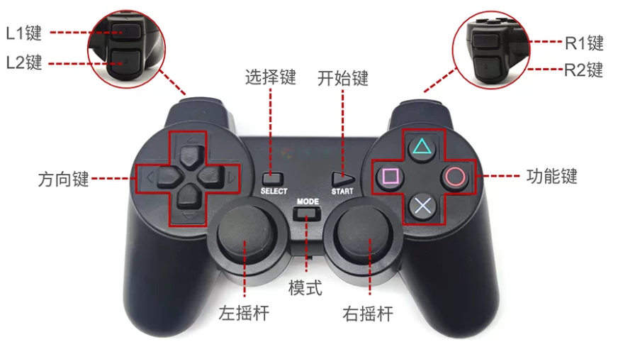
    - 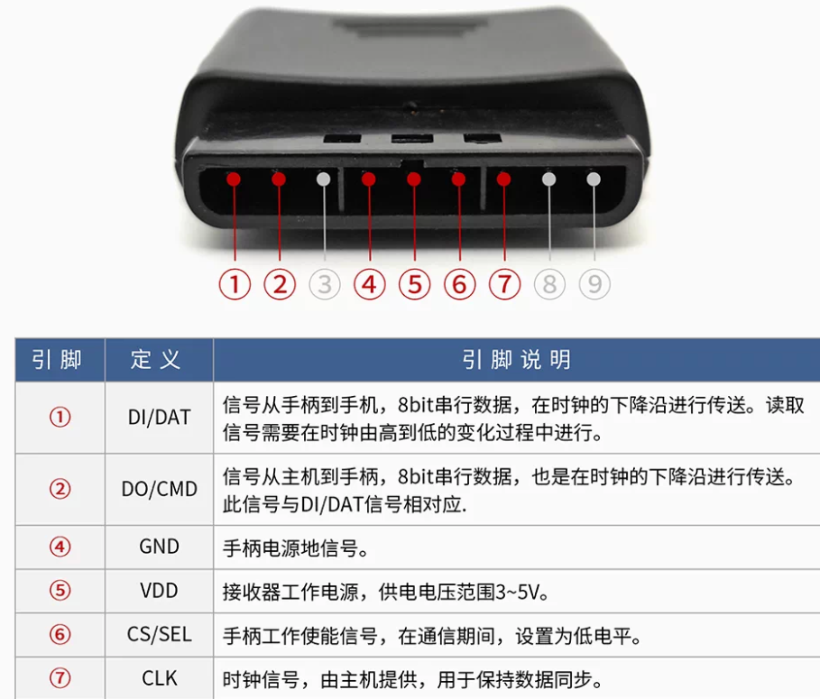
    - 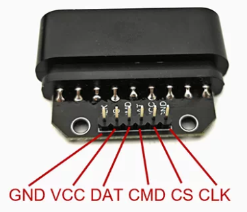

### 10月17日 遥控联调

10.17 联调时用 PS2 遥控测试整车运动，旋转时出现两个轮子卡住不动、左右平移异常的情况，排查过程与接线顺序问题记录在「全向移动底盘」的问题二、新问题三中。

## 六、PCB 底板设计与打板

**功能描述**：自行绘制集成底板，把电源输入、DC-DC、主控排母、DRV8833、舵机接口、PS2 接口集成到一块板上，替代易脱落的杜邦线与面包板；9.19 开始绘制原理图，10.10 首板焊接测试，10.16 等第二批板。

### 9.19 绘制电源模块封装

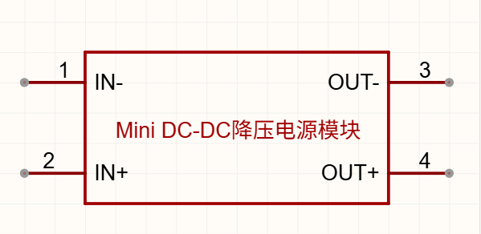
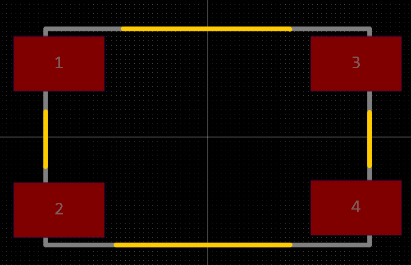
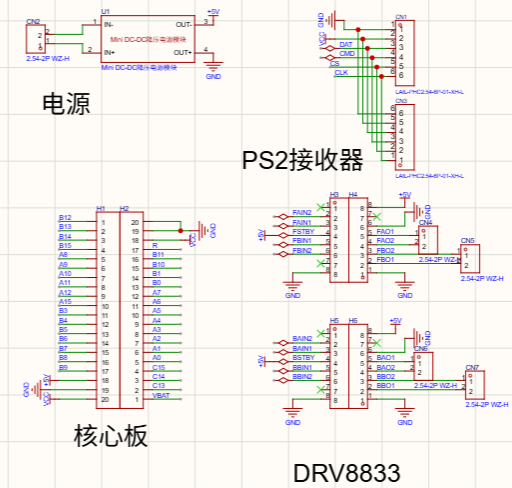

### 9.21

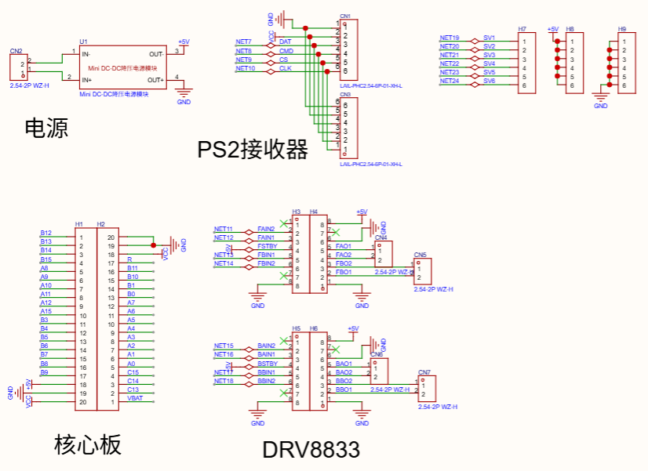

### 9.23

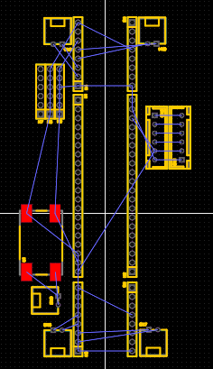

### 9.24

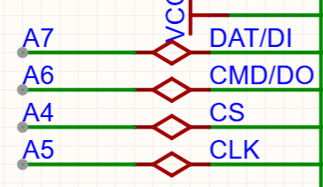
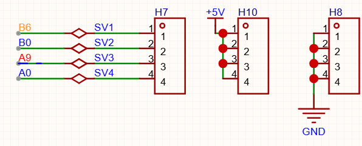
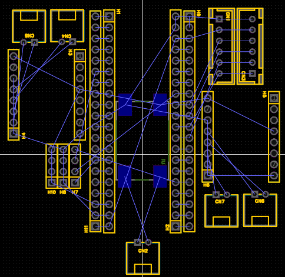

### 10.1

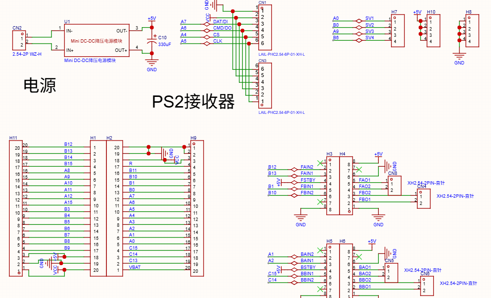
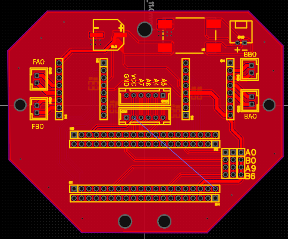
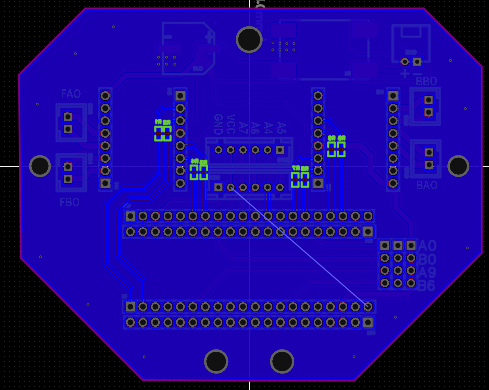

### 10.10焊接测试

首板焊接后共发现 6 个问题：电源相关 4 条记录在「电源系统」的 10.10 小节，调试接口与引脚分配 2 条记录在「主控系统与调试接口」的 10.10 小节。

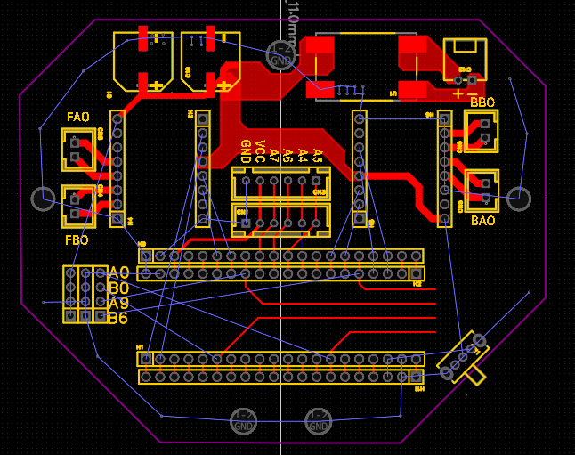

### 10.16 等待第二批 PCB

- 等PCB，目前在广州，预计17、18号到

## 七、整车结构、重量与装配

**功能描述**：整车结构由亚克力底盘承载电池、主控板、电机驱动与舵机夹取机构，按赛事 3.3.3 结构规范选材与布线；实测整车重量 964g，10.17 完成第一次组装。

### 9.18 结构规范与材料要求

分析相关规则：**3.3.3结构规范**

1. 建议采用较为牢固的材料进行机械结构的搭建，尽量避免采用热熔胶与其他物质的组合形式；
2. 线路设计时建议**采用集成电路板的方式**，单一使用**杜邦线**易出现连线脱落的情况； *官方物资表中的杜邦线和面包板应该是电控调试时使用，最终硬件设计使用集成电路板**!注意**：CRTC 官方物资表作为官方推荐的物资清单，是统一培训时使用的套件，参赛队员可考虑购买其他不在 CRTC 官方物资表内的物资参加比赛，但购买的物资仍需符合赛事规则 ->根据情况自行选择购买模块或直接芯片焊到PCB上*
3. 布线合理，**不允许线路过度裸露**；

### 整车重量核算（实测）

按实际称重分为三部分：

| 部件 | 重量 |
| --- | --- |
| 裸车 + 电路板 | 415g |
| 存储 + 电池盒 | 195g |
| 臂膀 | 354g |

**总重量：** 415 + 195 + 354 = **964g**

> 早期按物料清单逐项估算约 1379g，实测后以本表为准。

### 物资清单与成本

按手写物资记录整理，金额为实际采购价：

| 物料 | 数量 | 金额（元） | 备注 |
| --- | --- | --- | --- |
| 995 舵机 | 3 | 34.65 | |
| SG90 舵机 | 1 | 3.73 | |
| PCB 板 | 1 | 免费 | 自绘底板 |
| 18650 电池盒 | 1 | 0.7 | |
| 18650 电池 + 充电器 | 1 套 | 27.3 | |
| DRV8833 驱动模块 | 2 | 4.92 | |
| PS2 手柄 + 转接板 | 1 套 | 41.3 | |
| 底盘系统 | 1 套 | 44.4 | 原记为“降压模块”，后改记底盘系统 |
| STM32F103C8T6 | 1 | 9.34 | |
| 无线遥控器 | 1 | 14.88 | |
| 舵机及固定架 | 1 套 | 106 | |
| 夹爪打印件 | — | 免费 | 3D 打印件 |

**合计：约 287.22 元**（3D 打印件免费），低于赛事“不推荐超过 400 元”的成本线。

以上为 **1 辆车** 的物料成本；按预期 **2 辆车** 计算约为 **574.44 元**。

### 10.17 组装

1. 接线有时会断，换其他方式接线
2. 舵机丝印画反
3.

## 八、开源项目与第三方库说明

本项目在机器人制作与代码编写中使用的开源/第三方组件如下（组件均用于本队的开发工程，本仓库仅提交文档与配图，固件源码不在本仓库内）：

| 组件 | 来源与许可 | 用途 | 开发工程内位置 |
| --- | --- | --- | --- |
| STM32F1 HAL 驱动库 | STMicroelectronics，BSD-3-Clause | 主控外设初始化，GPIO、定时器、FLASH 等底层驱动 | `Drivers/STM32F1xx_HAL_Driver` |
| CMSIS（Cortex-M3 内核支持） | Arm，Apache-2.0 | 内核寄存器定义、启动与系统时钟支持 | `Drivers/CMSIS` |
| STM32Cube 工程模板 | STMicroelectronics，BSD-3-Clause | 启动文件、系统时钟与系统调用桩 | `startup_stm32f103xb.s`、`Core/Src/system_stm32f1xx.c`、`Core/Src/syscalls.c`、`Core/Src/sysmem.c` |

以上组件均保留原有版权声明，未修改其许可条款。PS2 手柄的通信时序由本队在 `Core/Src/ps2.c` 中自行实现（软件模拟时序，无第三方 PS2 库）；底盘运动、舵机、夹取与示教回放等业务代码（`mailun.c`、`motor.c`、`servo.c`、`chapter.c`、`teach.c` 等）均为本队自行编写。除上述组件外，未直接引入其他开源项目用于机器人制作与代码编写。
